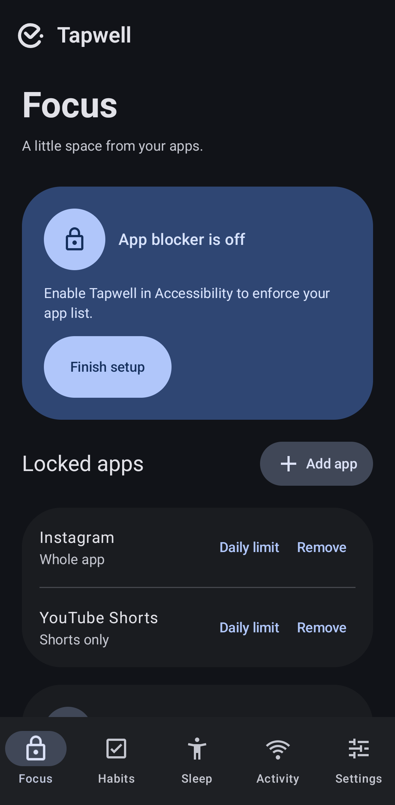
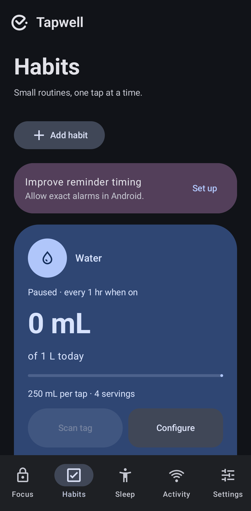
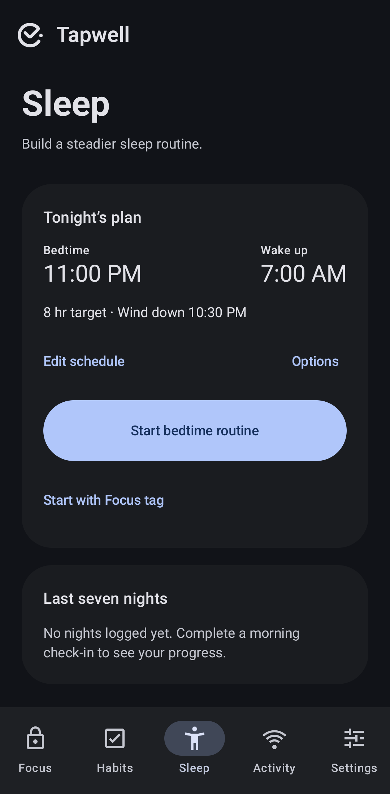
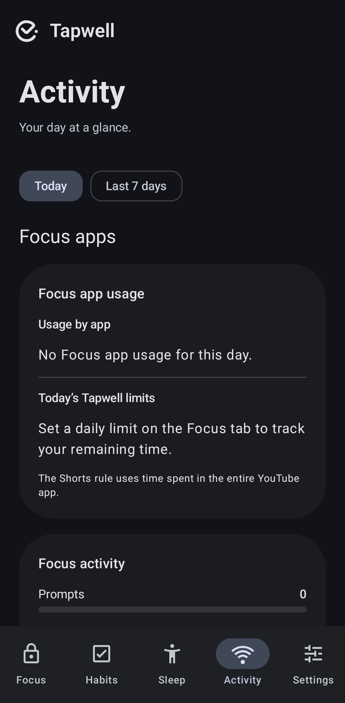
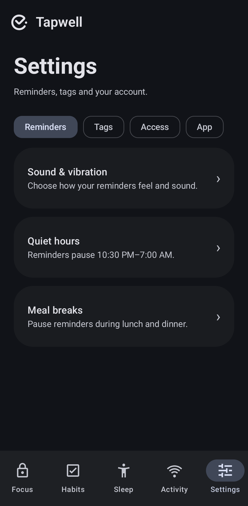
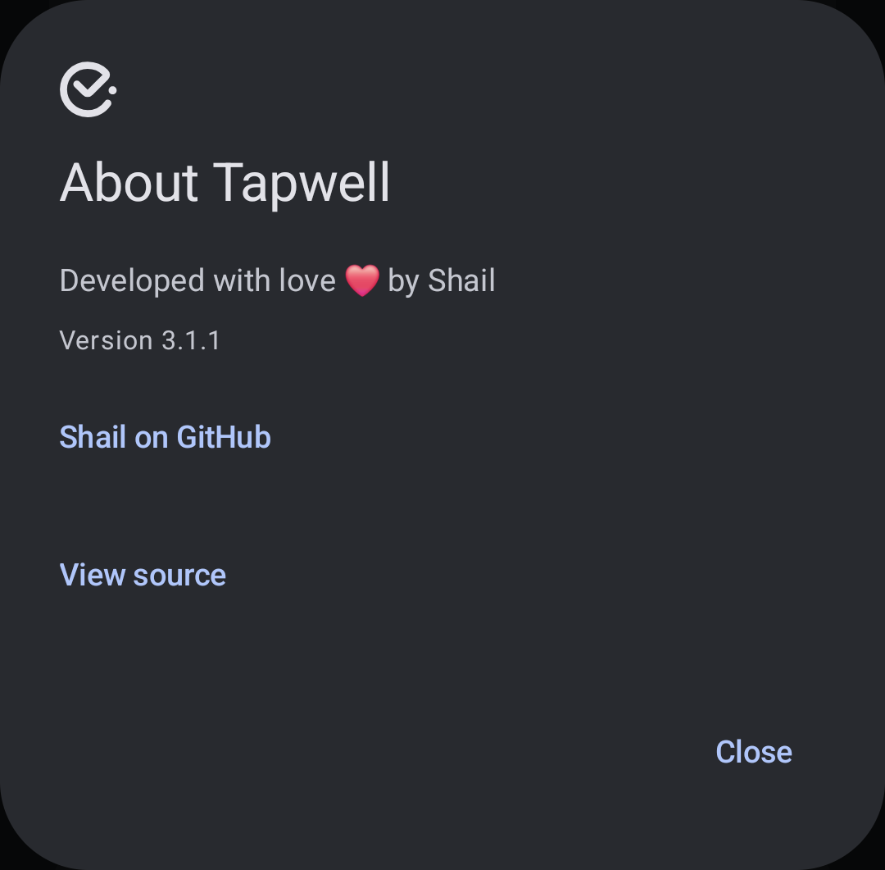

# Tapwell

Tapwell is a native Android app for setting NFC-backed app limits and keeping up with water, stand breaks, and other habits. Scan a physical tag to open a distracting app for a short session or to confirm a habit.

Developed with love ❤️ by Shail. [GitHub profile](https://github.com/Shail9802)

Tapwell was vibe coded with AI assistance. The app is open source under the [MIT License](LICENSE). Bug reports and pull requests are welcome.

## Screenshots

Tapwell 3.1.1 on a Samsung S21 FE, using its dark wallpaper palette. These show real setup/empty states; no habit or health records were created for the images.

| Focus | Habits | Sleep |
| --- | --- | --- |
| [](docs/screenshots/focus.png) | [](docs/screenshots/habits.png) | [](docs/screenshots/sleep.png) |
| Activity | Settings | About |
| [](docs/screenshots/activity.png) | [](docs/screenshots/settings.png) | [](docs/screenshots/about.png) |

[Full screenshot gallery and Water widget preview](docs/screenshots/README.md). System status/navigation bars are cropped; dialog images exclude the background screen. App content is otherwise unchanged.

## Features

- **Focus sessions.** Lock selected apps or the YouTube Shorts player, unlock them for a timed session with an NFC tag, and set up a location-aware work break.
- **Activity dashboard.** See screen time by Focus app, compare the last seven days, and check how much of each daily limit is left. Tapwell also charts Focus prompts, app launches, and habit logs.
- **Home-screen widgets.** Choose habits to log from a resizable widget, including when reminders are off. Swipe vertically through extra pages. An Activity widget shows daily totals, screen time, daily limits and a seven-day chart.
- **Habit reminders.** Track a daily water goal, take stand breaks, and create custom routines. Choose when reminders repeat, which habits require an NFC tag, and when overnight quiet hours pause alerts.
- **Flexible alerts.** Use Android notifications, optional reminder pop-ups, a chime, or vibration. Create extra reminders in Samsung Reminder or your calendar where supported.
- **Google account and backup.** Sign in with Google and approve private Drive sync for the same account to restore core app rules, NFC pairings, and habit settings on another phone. Official APK users do not need a Cloud project or OAuth client.
- **Optional water export.** Share newly confirmed Water drinks with Health Connect using water-write permission only. Samsung Health water import depends on its hydration support; direct Samsung Health integration is not included.

## Sleep routine

The Sleep tab provides a suggested bedtime, wind-down time, wake time and duration target. Set your age and preferred wake time before using the plan. A local nearest-neighbour estimate uses up to seven well-rested diary entries near your preferred wake time, with age-based duration bounds; it uses a starting target until three suitable entries exist. Earlier bedtime changes advance by up to 15 minutes. Suggestions require your approval through **Sleep → Options → Apply to quiet hours**.

Start a bedtime session manually or with an existing Focus NFC tag. The session pauses habit reminders until your selected wake time; extend it by an hour when needed. Confirm and correct sleep times and a rested rating in the morning. The last seven nights appear as a bar chart and diary. The diary retains up to 90 entries locally, has a delete control, and is excluded from Drive sync and health exports. This first version learns from your confirmed diary; automatic phone-activity estimates, scheduled wind-down notifications, and sleep-specific Focus blocking are not yet included. It does not measure sleep or diagnose sleep disorders.

## Appearance

Tapwell 3.0 adopts Material 3 Expressive: native `MaterialExpressiveTheme`, expressive motion, contrasting corner shapes, prominent habit numbers, press-responsive primary actions and the Material wavy Water progress indicator. Dynamic wallpaper colors and Samsung palette support remain. See [design guidelines](DESIGN.md). The expressive library is pinned to `material3:1.5.0-alpha03` for compatibility with the current Compose toolchain; these APIs are experimental.

The Water habit widget fills upward with a wallpaper-colored wave as confirmed drinks approach the daily goal. For example, 2 L of a 3 L goal fills roughly two-thirds of the tile. Fill is capped at 100%, while the displayed total can exceed the goal. Larger tiles also show a percentage or Goal complete; other habits show their next-reminder/manual-tracking state. Partially filled Water tiles have a gently moving surface using launcher-hosted animation frames, without a background animation service. Battery saver and disabled system animations use a still fill. Widget setup includes a sample motion preview that does not log a drink. Android and the launcher control widget refresh and animation behavior.

UI changes are reviewed with phone screenshots of tabs, settings, dialogs and widgets. See the [3.1.0 visual review and its coverage limits](docs/ui-review-3.1.0.md). Settings and Sleep share consistent card insets, while navigation, primary actions and progress changes use restrained Material motion.

**Settings → App → Region & units** follows your phone's country by default, with a searchable country picker and explicit Metric, US customary or Imperial override. India and Canada default to metric; the US defaults to US customary. No location permission or GPS lookup is used. Water goal and drink fields accept decimal mL/L or the selected system's fluid ounces, cups (US), pints and gallons. US and Imperial measures are explicitly distinguished. Work radius supports metres/kilometres or feet/miles. Stored water history and health exports remain in canonical millilitres, so changing display units does not change previous drinks. Regional preferences stay on each phone.

Choose **Settings → App → Time format** for Device, 12-hour or 24-hour clocks. Sleep, meal/work/quiet-hour pickers and next-reminder labels follow this preference. Habit intervals and repeats accept seconds, minutes, hours or days (up to seven days), with existing minute settings preserved. Android may delay short alerts during idle. Update all synced devices to 2.7 or newer before syncing second-precision settings.

Settings uses tappable rows with descriptions and a horizontally scrollable category selector. Advanced NFC/device-administration options are under **App → Advanced device options**. Habit widgets adapt the grid to the selected habits: one fills the widget and two divide its space. Content uses a shared rounded surface with an inset around the edges; overflow habits remain scrollable.

Settings groups controls into **Reminders**, **Tags**, **Access** and **App** categories. Sleep plan explanations are under **Options → About this plan**. Widget detail adapts to available space: compact Activity widgets show daily totals, medium widgets add the seven-day chart, and tall widgets can show daily limits. Open Activity in the app for the complete dashboard.

Tapwell uses Jetpack Compose Material 3 with the phone’s dynamic colors and light or dark appearance.

Tapwell follows device colors by default. Its **Follow device** launcher icon uses plum and lime in standard mode and lets supported launchers tint the mark when themed icons are enabled. On Galaxy phones, the launcher switch is **Wallpaper and style → Color palette → Apply palette to app icons**.

In **Settings → App → Colors & app icon**, you can turn off **Follow device colors** to use Tapwell’s palette. The icon has separate overrides. **Normal Android** provides the brand artwork, **Android Monet** uses the system accent palette, and **Samsung Monet** uses a softer wallpaper palette and a smaller mark. Your launcher can still apply its own icon tint.

## Install and set up

Tapwell requires Android 12 or later and an NFC-capable phone.

1. Download the `.apk` from the latest release and open it on your phone. Allow installation from that source when Android prompts you. [GitHub Releases](https://github.com/Shail9802/Tapwell/releases/latest) · [Samsung installation help](https://www.samsung.com/us/support/troubleshoot/TSG10001913/)
2. Open Tapwell and go to **Settings**. Turn on NFC under **Access** and pair tags under **Tags** for **Focus**, **Water**, and **Stand**. Hold each tag against the back of your unlocked phone while Tapwell’s scanner is open. You can name and pair several tags per task, such as Home and Work.
3. From **Settings → Access → App blocking**, enable **Tapwell app blocker** in Android Accessibility. If the switch is restricted, open **Settings → Apps → Tapwell → ⋮ → Allow restricted settings**, then return to Accessibility. [Android’s restricted settings guide](https://support.google.com/android/answer/12623953)
4. Allow notifications and exact alarms in **Settings → Access**. Then go to **Habits → Configure** to turn on and customize each reminder.
5. In **Settings → Access → Pop-up reminders**, allow Tapwell to appear over other apps. A due reminder can then open an animated prompt over the current app or the lock screen. Unlock the phone to see habit details and scan the tag or mark the habit done. Standard notifications still open the prompt when tapped.

## How the rules work

- **Habit widget.** Long-press your Home screen, choose **Widgets → Tapwell → Tapwell habits**, then select the habits to include. The grid fills the space based on the selected habits; resize it to show more. Swipe up or down for extra pages. Long-press and choose the launcher's **Edit** or **Settings** action to change the selection. For NFC habits, tap the tile and scan a paired tag to log immediately, without a second confirmation. Manual habits still ask for confirmation. Logging works with reminders off; when reminders are on, logging restarts their interval.
- **Activity widget.** Add **Tapwell activity** from the same widget picker and resize it for a compact summary or a larger dashboard. It shows today’s habit logs and app launches from Focus prompts, plus a seven-day bar chart. Grant Usage access in Tapwell to show Focus app screen time and daily limits. Tap the widget to open **Activity**, or use the refresh button for an updated snapshot. Widgets refresh after Tapwell data changes and periodically through Android, which may delay background updates.

- **Device administration.** Open **Settings → App → Advanced device options → Device administration → Activate device admin** to review Android’s confirmation screen. The dialog shows Tapwell’s current admin or owner status. Use **Open security settings** to find Android’s Device admin apps controls and deactivate it. Standard device-admin activation alone does not grant direct NFC control. Device-owner enrollment is a separate management setup, usually performed on a new or factory-reset device.

- **NFC automation.** Open **Settings → App → Advanced device options → NFC automation** for Samsung Modes and Routines instructions and a shortcut to Samsung’s app. Create the routine there using a Tapwell notification or app opening as the condition and NFC On as the action, where available. Direct NFC control is also available on Android 16 or later when Tapwell has system-app or managed-device owner status and secure-settings permission. Its switch shows eligibility on the current phone. When enabled, Tapwell requests NFC activation for NFC reminders and scanners.

- **Focus.** Instagram and YouTube Shorts are selected by default. To lock another installed app, choose **Add app**, select it, then confirm with **Add to Focus**. Opening a locked app takes you to a screen where you can scan your Focus tag for a session. The default session lasts 10 minutes. The Shorts rule targets the player in the official YouTube app and keeps regular browsing and videos available. YouTube UI updates can change which controls are exposed to Android.
- **Removal.** Select **Remove** next to a rule and scan your Focus tag. The rule stays in force for two hours and then expires automatically. You can cancel a pending removal before it expires.
- **Work break.** Set your location while at work, choose the radius, days, hours and break length, and scan your Focus tag to save the rule. Start a break from an app’s lock screen. Tapwell checks precise location at the start, allows one shared break per work window, and ends it no later than the end of that window.
- **Water.** Defaults to 1,000 mL per day and 250 mL per serving, or four servings. A due reminder repeats every five minutes by default during active hours until you scan the Water tag. Logging a serving restarts the configured interval, which defaults to 60 minutes. A scan between reminders asks for confirmation before logging. Reminders stop when you reach the daily goal. The total resets at local midnight, and the first reminder of the new day is due one interval later.
- **Water notification.** The pending alert stays in the notification shade with a **Scan Water tag** action. If Android allows an individual swipe, Tapwell restores the alert silently outside quiet hours and reopens the scanner when reminder pop-ups are enabled. Closing the scanner keeps the reminder pending. A matching tag clears the alert and restarts the timer.
- **Standing.** Scan the Stand tag to complete the current reminder and restart the interval. Overdue reminders retry every five minutes. Standing reminders continue while enabled.
- **Custom habits.** Open **Habits → Add habit** and enter a name and reminder interval. Turn on **Require NFC tag** to pair a separate tag from the habit card. Reminders start once the tag is paired. With that switch off, tap **Mark done**. Completion restarts the reminder interval.
- **Repeat alerts.** Turn **Repeat until done** on or off for each habit, including Water and Stand. The repeat interval defaults to five minutes and can be changed independently of the main interval. Turning repeats off gives you one alert per cycle.
- **Sleep quiet hours.** In **Settings → Reminders → Quiet hours**, habit notifications, pop-ups, NFC prompts, and repeat cycles pause overnight. It is on by default from 22:30–07:00 and works across midnight. Customize or disable it if your sleep schedule differs. A due habit sends one reminder when quiet hours end; it does not build a backlog. This schedule stays local to each phone.
- **Reminder alerts.** In **Settings → Reminders → Sound & vibration**, switch between a gentle two-note chime with strong vibration and vibration only. The built-in chime gets a boost at low notification volume and softens at the top of the slider. For quiet alerts, use Tapwell’s vibration-only setting or Android’s Vibrate mode. Android’s Silent mode, Do Not Disturb, and notification channel settings still control delivery.
- **Test alerts.** Use **Send test alert** in **Reminder alerts** for a water preview or in a habit’s **Configure** screen for that habit. Open the notification and scan a paired tag when the prompt asks for one. A test scan leaves the habit timer and water total as they are.
- **System reminder drafts.** Open a saved habit’s **Configure → Use another reminder app** menu and choose **Share to Samsung Reminder** or **Add to calendar**, when available. Review the entry and save it in the receiving app. These are separate reminders. Use Tapwell to complete the habit, scan a tag, or restart its timer.
- **Google account and Drive sync.** Open **Settings → App → Google account → Sign in with Google** on each device and choose the same account. Approve private Drive sync; it is bound to your signed-in account. Tapwell backs up app locks, paired tags, habit and alert settings, theme colors, and work rules including the saved work location. On first connection, backed-up settings take priority where they overlap. Use **Sync now** to refresh. **Sign out** stops sync on that phone and retains its local configuration. Active unlocks, reminder timers, daily progress, activity history, daily app limits, widget selections and Android permissions are device-specific. See the [privacy policy](https://shail9802.github.io/Tapwell/privacy.html) for deletion controls.
- **Manage tags.** Use **Settings → Tags** for Focus, Water, and Stand. Use **Tags** on an NFC habit card for that habit. Any paired tag works for its task. Adding or replacing a tag only requires scanning the new tag. Removing a tag still requires a paired tag.
- **Recover unavailable habit tags.** For Water, Stand or a custom habit, open its tag manager and choose **Lost access to these tags?** Review the confirmation, verify your phone's screen-lock PIN, pattern or password, then scan your actual replacement tag. Old pairings stay intact if you cancel or scan an invalid tag. A successful recovery replaces that habit's tag list and keeps its progress and settings. With sync enabled, the replacement is shared with other devices on the same Google account. Focus tags are excluded from this recovery path.
- **Water & health apps.** Open **Settings → App → Water sync** and allow writing water intake. Only confirmed Water drinks logged after connection are exported, with the original serving volume, timestamp and time-zone offset. NFC, manual and widget completions use the same path; previews, tag pairing, Stand and custom habits do not create hydration records. Older daily totals are not backfilled. Stable event IDs prevent retries from adding the same event twice. Pending exports survive app restarts; Android can delay background retries. **Export to Health Connect** retries immediately and reports how many queued drinks were sent, or that no new drinks are waiting. **Disconnect export** stops new exports and cancels queued ones; it keeps local drinks and existing Health Connect entries. Delete exported entries from Health Connect's Data and access controls. This export and its permission are local to each phone and independent of Google Drive sync.

- **Direct tag scans.** Scan a paired Tapwell NFC text tag from the unlocked phone to open a confirmation before logging the habit. This works even with reminders off. Android must route the tag to Tapwell; blank tags and unrelated NDEF formats do not currently open this flow. Tagfold's Tapwell Text tags are supported. Canceling the prompt changes no habit data. Water reminders stop at your goal, and you can still confirm extra drinks. Widget-initiated NFC scans log immediately because you intentionally opened the scanner.
- **Meal snooze.** Open **Settings → Reminders → Meal breaks** to enable or edit quiet windows. Lunch defaults to 12:30–14:00 and dinner to 19:30–21:30. Due alerts wait until the window ends.
- **Activity dashboard.** Open **Activity** to chart Focus prompts, exits, and app launches, along with habit reminder cycles and completions. A reminder cycle is counted once when a habit becomes due, so repeat notifications and quiet hours do not inflate the number. Select **Open Usage access** and grant access to Tapwell to see the screen time charts. The donut shows each Focus app’s share of usage. In **Last 7 days**, tap a bar to see that day’s breakdown. **Today’s Tapwell limits** shows time used, time left, or time over the cap.
- **Daily focus limits.** In **Focus**, choose **Daily limit** next to a locked app and enter an allowance in minutes. If a Focus tag is paired, scan it to save the change. Tapwell counts foreground time and resets the allowance at local midnight. The Shorts rule uses total YouTube time. To mirror a Digital Wellbeing timer, enter the same allowance in Tapwell.

## Samsung Health compatibility

Health Connect supports hydration, but not every Samsung Health version reads it. Tapwell checks the installed Samsung Health app's declared hydration-read permission and explains the result in **Water & health apps**. The tested Samsung Health 7.1.3.005 on S21 FE did not declare hydration read/write access. Exporting to Health Connect therefore does not put drinks into that version's Samsung Health Water tracker.

A native Samsung Health water adapter is implemented, with a separate opt-in and a single active export destination. It writes confirmed Water drinks and reads only Tapwell-owned record IDs to avoid duplicate retries. It remains **unavailable pending Samsung partner approval** for `app.tapwell` and its signing certificate. The standard OSS build does not include Samsung's proprietary SDK; no partner credentials are shipped. See [Samsung's app process](https://developer.samsung.com/health/data/process.html). Stand-break counts and custom habits are not exported as water, exercise or steps.

The Water intake READ/WRITE partnership application was submitted on **12 November 2026**. Samsung confirmed receipt and marked it under review; its confirmation page estimates 3-5 business days. Approval and write access have not yet been granted.

In **Water & health apps**, choose Health Connect or Samsung Health (when available), review the disclosure and connect. Disconnect before switching destinations: previously sent drinks remain where they were sent and are not replayed into the new destination. **Water privacy & permissions** lets you view the latest 100 local water events, export the full retained journal as JSON, and delete the local journal and pending queue while stopping export. Deletion keeps daily habit totals and records already delivered to health apps; clear Android app storage to remove all local Tapwell data. Manage external records in the receiving health app.

Partner development only: obtain Samsung SDK 1.1.0 under its separate license and pass `-PtapwellSamsungSdk=/absolute/path/samsung-health-data-api-1.1.0.aar`. The adapter compiles against that local AAR; never commit or redistribute the SDK as an MIT asset. Connection remains gated until `-PtapwellSamsungApproved=true` is set **after** Samsung approves the exact package/certificate and required water access. Do not publish native SDK builds before approval. Default builds remain independent of the proprietary dependency and can use Health Connect.

Private privacy, grievance and security contact: **shailmshah.ss@gmail.com** (Shail Shah). See [privacy operations](PRIVACY_OPERATIONS.md), [security reporting](SECURITY.md) and the [privacy policy](https://shail9802.github.io/Tapwell/privacy.html). Optional Drive backup can include custom habit names (which may reveal health details) and saved work coordinates, but excludes water-event history and health-export consent/status.

Health Connect is built into Android 14 and later; earlier supported Android versions require the Health Connect app. For Google Play distribution, declare the water-write use case in Play Console's health-app permissions declaration. No health-read, profile or unrelated health-data permissions are requested. See [Android's integration guide](https://developer.android.com/health-and-fitness/health-connect/get-started).
## Google account setup

Official APK users only sign in and approve sync. Standard Google sign-in and Drive API access do not require a paid authentication backend for this app. Google quotas and account policies still apply. Focus and habits work without signing in.

Tags are shared between devices signed into the same Google account. Signing out or changing accounts does not undo settings already downloaded to the phone. If an unfamiliar habit pairing was restored, use the habit tag recovery flow above and **Sync now** on the correct account.

Version 2.2.0 uses the dedicated **Tap well** project (`tapwell-shail9802`). If you connected an older version through the previous testing project, sign in again after updating. The new project starts a fresh backup from your phone's configuration. Make sure that phone contains the settings you want to keep; old-project backups are not automatically imported.

For maintainers or independently signed builds:

1. Enable **Google Drive API** in your Cloud project and configure an External consent screen with a homepage and privacy policy.
2. Declare `openid`, `https://www.googleapis.com/auth/userinfo.email`, `https://www.googleapis.com/auth/userinfo.profile`, and `https://www.googleapis.com/auth/drive.appdata`.
3. Create an **Android** OAuth client for your application ID and signing certificate SHA-1. Register every certificate you distribute. The official application ID is `app.tapwell`; Google permits a package/certificate pair in only one project.
4. Create a **Web application** OAuth client in the same project. Its public client ID is Credential Manager's audience. Native sign-in needs no browser redirect URL here. Never embed a client secret in the APK.
5. Override Gradle properties `tapwellGoogleWebClientId` and `tapwellGoogleProjectId` for your own project. Defaults contain only the official project's public identifiers. Independently signed APKs need a matching Android registration.
6. Add test users while the consent app is in Testing. Publish for general availability and complete any verification Google requests.

Tapwell uses Android Credential Manager, verifies Google's token signature, audience and nonce, then authorizes the same account's private Drive folder through Google Play services. No developer-operated authentication server is required.

The [homepage](https://shail9802.github.io/Tapwell/) and [privacy policy](https://shail9802.github.io/Tapwell/privacy.html) are hosted by GitHub Pages from `docs/` on `main`.

## Test with Tagfold

1. Open a task’s tag manager in Tapwell and tap **Generate Tagfold code**. Copy the whole `tapwell-tag:…` value into a **Text** tag in Tagfold on a second Android phone.
2. Start emulating the tag in Tagfold, then tap **Add tag** in Tapwell. Keep both phones unlocked with both apps visible and hold their NFC antennas together.
3. To add a second emulated tag, reopen the tag manager to generate a fresh code, switch Tagfold to the second tag, tap **Add tag** in Tapwell, and touch the phones together. Either code can then complete the task.

Use a fresh code for each emulated tag. Anyone with the same code can emulate that tag, so keep codes you use outside testing private.

## Permissions and data

Accessibility lets Tapwell detect the foreground app and identify the YouTube Shorts player. Usage access provides screen time for the charts and daily limits. Usage and activity counts stay on the phone. NFC reads the tags you pair, and precise location is used when setting a work location or starting a work break. Tag IDs and the saved work location are included in the private Drive backup only when you connect Google Drive.

Android may delay five-minute retries during deep idle, even with exact alarms enabled. The phone owner can disable the accessibility service that enforces app locks. [Android’s alarm timing documentation](https://developer.android.com/training/monitoring-device-state/doze-standby)

## Build from source

Contributors and AI coding tools should start with [AGENTS.md](AGENTS.md), the shared development guide. It covers product rules, UI alignment/motion, device testing, screenshots, permissions, builds and releases. The [architecture guide](docs/architecture.md) documents the on-device service layer, source map, storage, Google identity/Drive sync and health-export contracts. `CLAUDE.md` and `GEMINI.md` point to the same shared instructions.

Open this folder in Android Studio with JDK 17 or newer, Android SDK Platform 36, and Android SDK Build-Tools 36.0.0. From PowerShell, build the app and run the unit tests.

```powershell
.\gradlew.bat :app:assembleDebug :app:testDebugUnitTest
```

On macOS or Linux, run `./gradlew :app:assembleDebug :app:testDebugUnitTest`. The debug APK is at `app/build/outputs/apk/debug/app-debug.apk`.

The bundled Gradle wrapper is distributed under its upstream Apache 2.0 license.
