# Tapwell architecture and service-layer guide

Read [AGENTS.md](../AGENTS.md) first. This document is part of the shared development instructions and describes the current source layout and data contracts. Recheck the implementation when changing behavior.

```mermaid
flowchart TD
    Inputs["Screens · NFC · widgets · reminder confirmation"] --> App["Existing app orchestration"]
    App --> Store["Store + domain rules"]
    Store --> Local["App-private settings, progress and activity"]
    Store --> Reminders["Reminder reconciliation"]
    Store --> Widgets["Widget refresh"]
    Store --> Water["Confirmed Water event journal"]
    Water --> Export["Opt-in water export job"]
    Export --> Health["One selected health destination"]
    Local --> Allowlist["Portable configuration allowlist"]
    Allowlist <--> Sync["Account-bound sync coordinator"]
    Sync <--> Drive["User's private Drive appDataFolder"]
```

The diagram shows logical data flow, not a promise that every low-level store write directly invokes all side effects. Callers use the existing orchestration to reconcile reminders and refresh UI/widgets. Water events, sleep history, activity counters and active timers do not pass through the portable configuration allowlist.

## Source map

All Kotlin paths below are relative to `app/src/main/java/app/tapwell/` unless noted.

| Area | Main files | Responsibility |
| --- | --- | --- |
| App shell and scan orchestration | `Activities.kt` | `TapActivity`, `MainActivity`, Focus gate, scanner lifecycle and app-level operations |
| Screens and dialogs | `Dashboard.kt`, `ConfigDialogs.kt`, `UiSection.kt` | Destinations, configuration, reusable card/label alignment |
| Theme and motion | `Theme.kt`, `Expressive.kt`, `Appearance.kt` | Dynamic colors, Material Expressive shapes/motion, icon variants |
| Domain rules | `Rules.kt` | Habits/tags, completion, deadlines, work windows, quiet hours and reminder-cycle decisions |
| Local persistence | `Store.kt` | App-private preference-backed state, habit logging, activity counts and export journal updates |
| Focus enforcement | `FocusService.kt`, `FocusUsage.kt` | Accessibility-based gates, Shorts detection, Android usage totals and daily caps |
| NFC | `NfcReading.kt`, `ManageTags.kt`, `HabitTagRecovery.kt`, `HabitTapActivity.kt` | Physical/NDEF reading, passive scans, pairing, recovery and explicit confirmation |
| Reminders | `Reminders.kt`, `ReminderActivity.kt`, `ReminderAlerts.kt`, `ReminderSoundProvider.kt` | Alarm reconciliation, notification lifecycle, scan pop-up, vibration and chime |
| Work access | `WorkLocation.kt` | User-initiated location checks and break eligibility |
| Units/time | `Units.kt`, `Timing.kt` | Country/unit preferences, canonical quantity conversion and clock/duration inputs |
| Sleep | `SleepPlan.kt`, `SleepRoutine.kt` | Local diary, bounded suggestion algorithm, bedtime session and morning check-in |
| Activity charts | `ActivityChart.kt`, `FocusUsageCharts.kt` | Habit/Focus counts, Android usage charts, daily limits |
| Widgets | `TapwellWidgets.kt`, `WidgetLayout.kt`, `WidgetActivities.kt` | RemoteViews, responsive grids, selection, logging and water motion |
| Google identity | `GoogleSignIn.kt`, `GoogleTokenVerifier.kt`, `GoogleAccountDialog.kt` | Credential Manager sign-in, token validation and account UI |
| Configuration sync | `SetupSync.kt`, `DriveSetup.kt`, `PortableSetup.kt`, `SetupMerge.kt` | Drive authorization, replicas, allowlisted settings, merge and Android job |
| Water journal/export | `WaterEvents.kt`, `WaterHealth.kt`, `WaterHealthDialog.kt`, `SamsungWater.kt` | Confirmed drink events, opt-in destination, retry/idempotency and privacy controls |
| Platform integrations | `SystemReminders.kt`, `NfcAutomation.kt`, `DeviceAdministration.kt` | External reminder drafts, Samsung routines and device-admin status |
| Samsung implementation variants | `app/src/samsung/.../SamsungWaterApi.kt`, `app/src/noSamsung/.../SamsungWaterApi.kt` | Licensed implementation or default no-SDK stub |
| Android entry points/resources | `app/src/main/AndroidManifest.xml`, `app/src/main/res/` | Permissions, activities, receivers, services, widgets, icons and XML layouts |
| Tests | `app/src/test/java/app/tapwell/` | Pure rule, identity, merge, unit, recovery, sleep and water-event tests |

## Service layer, storage and data flow

There is no developer-operated user database, REST API, Firebase dependency or authentication server. Do not invent one to implement a local feature. Keep network, SDK and persistence work out of composable rendering and off the main thread.

Normal habit completion flows from a reminder, widget or explicit habit confirmation into `Store.logHabit`, domain completion rules and the local preference transaction. Water also appends a `WaterEvent` with the serving volume at that moment. Reconcile reminders, clear the pending alert when appropriate and refresh widgets through the existing orchestration. If export is enabled, schedule the existing export job. Do not create separate accounting paths for widgets, NFC and manual logging.

`Store` publishes revisions for UI updates. Configuration sync uses an explicit group/key allowlist in `PortableSetup`; adding a preference to the store does not automatically make it portable. Decide and document whether each new setting is local or synced. Maintain backward decoding/defaults for existing installations and legacy minute-based durations.

| Data | Location and portability |
| --- | --- |
| Focus list, paired tags, habit settings, chime, wallpaper-color preference, work rules/coordinates | Local; selected groups may enter optional private Drive configuration sync |
| Daily water/progress, activity counts, reminder timers, active unlock/removal deadlines, daily app caps | Device-local; never merge these as cross-device counters |
| Quiet hours, meal snoozes, regional/time preferences, widget choices, Android permissions/admin status | Device-local; inspect the allowlist before changing this boundary |
| Sleep diary/session/preferences | Separate local sleep storage; excluded from Drive and water export |
| Water-event journal and export queue/consent/destination | Device-local; excluded from Drive configuration sync |
| Identity and sync metadata | Bound to the signed-in Google account/project; never log raw tokens |

Use app-private storage and existing helpers. Do not enable Android backup indiscriminately: the application currently sets `allowBackup=false`. New persistence formats need validation, limits, migration/default behavior and tests for malformed/older input. Preserve deadline behavior based on wall time, elapsed time and boot identity; do not reduce lock enforcement to an easily shifted wall clock.

### Google identity and Drive

- Credential Manager supplies Google identity. Preserve RSA signature, issuer, audience, nonce, expiry/issued-at and verified-email checks in `GoogleTokenVerifier`. Decoding a JWT is not verification.
- Drive access is separately authorized for the same signed-in account. Keep account/project matching and sign-out cancellation checks.
- Drive stores schema-1 per-installation replica JSON in the user's `appDataFolder`. Group changes use revisions and source IDs for deterministic ordering, with null values representing deletion. Inspect `mergeSetup` before changing conflict behavior.
- On first connection, remote settings take priority where they overlap; local-only groups can be retained. Disconnect/account change resets replica metadata so queued changes cannot leak to another account. Sign-out retains restored local settings; it is not data erasure.
- Public OAuth client IDs/project IDs are not secrets. Client secrets, refresh/access tokens, private keys and keystores must never enter source, screenshots or logs. Independent package/signing identities need matching OAuth registrations; official APK users do not create clients.
- Preserve bounded network responses, timeouts, disabled redirects for credential-bearing requests and useful consent/error states. Sync denial or network loss must not prevent local Focus/habit use.

### Water integrations

- Only a genuinely confirmed Water serving creates a hydration event. Pairing, previews, test reminders, Stand and custom habits never do.
- Preserve the event's stable ID, original timestamp, time-zone offset, canonical millilitres and destination. Retries must be idempotent. Do not infer old drink events from a daily total or replay records into a different destination.
- One active destination at a time. Require disconnect before switching; disconnect cancels pending export intent but does not erase already delivered external records.
- Default Health Connect access is hydration write only. Its exports do not guarantee Samsung Health imports them. Keep the installed-version explanation honest.
- Direct Samsung support is gated by a separately supplied licensed SDK and exact package/certificate partner approval. Do not set `tapwellSamsungApproved=true` based on an application having been submitted or an old conversation. Check actual approval before public distribution.
- `tapwellSamsungSdk` selects the Samsung source set; normal OSS builds select the stub and remain independent of the proprietary AAR. Never commit the AAR, partner access codes, downloaded agreements containing private information or local development artifacts.
- Event retention currently preserves pending entries and recent history; pruning occurs on new logging, not an exact scheduled purge. Local journal deletion, disconnect, sign-out and external-record deletion have different effects. Keep disclosures and privacy operations in sync with code.
