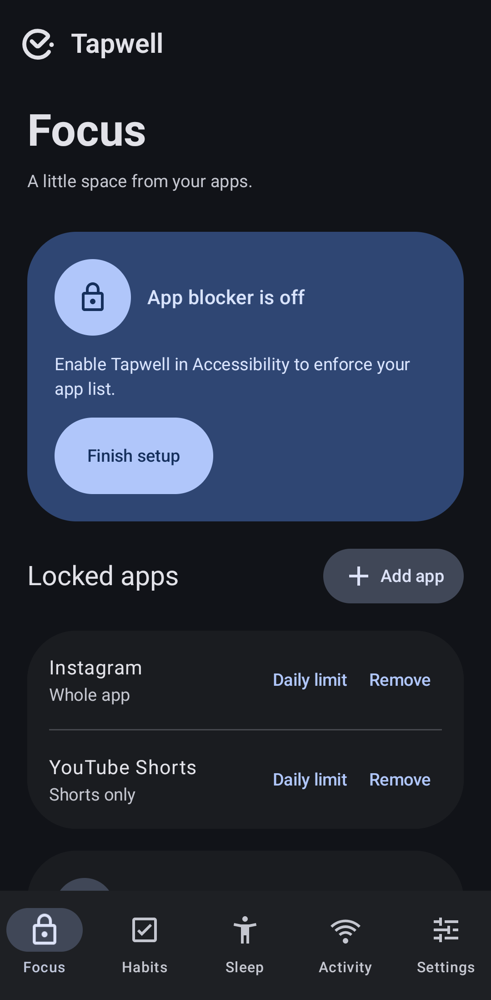
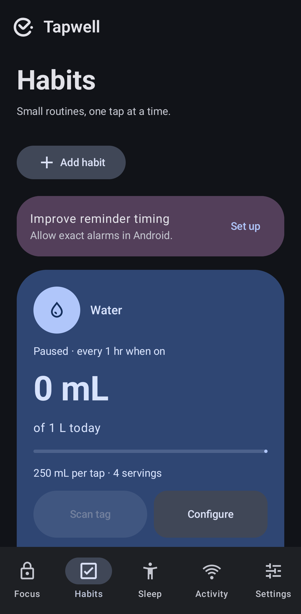
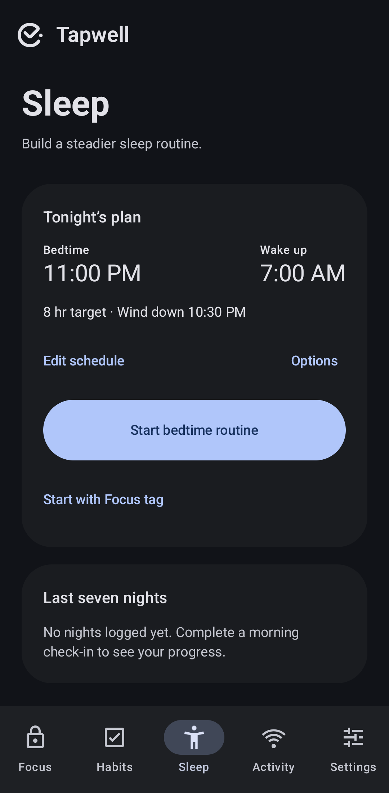
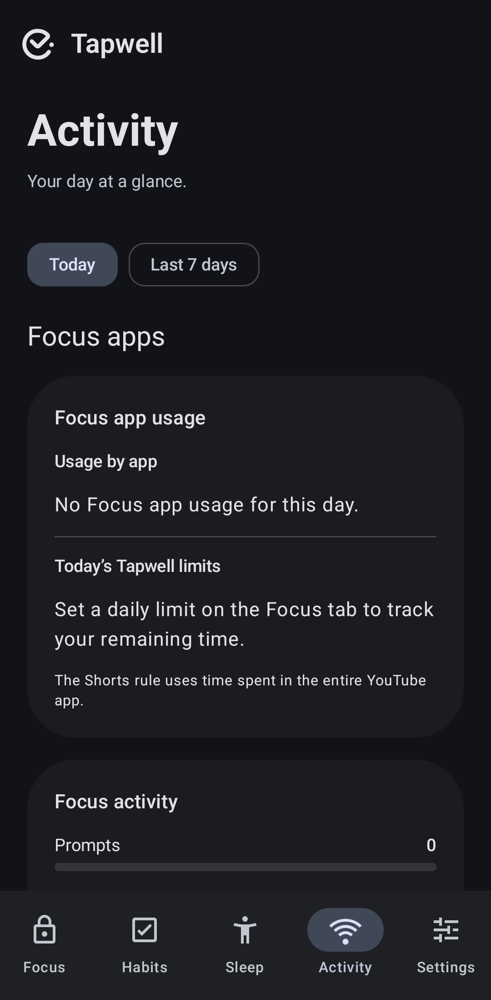
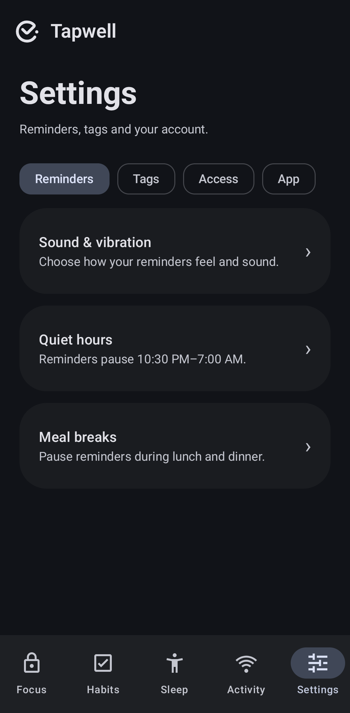
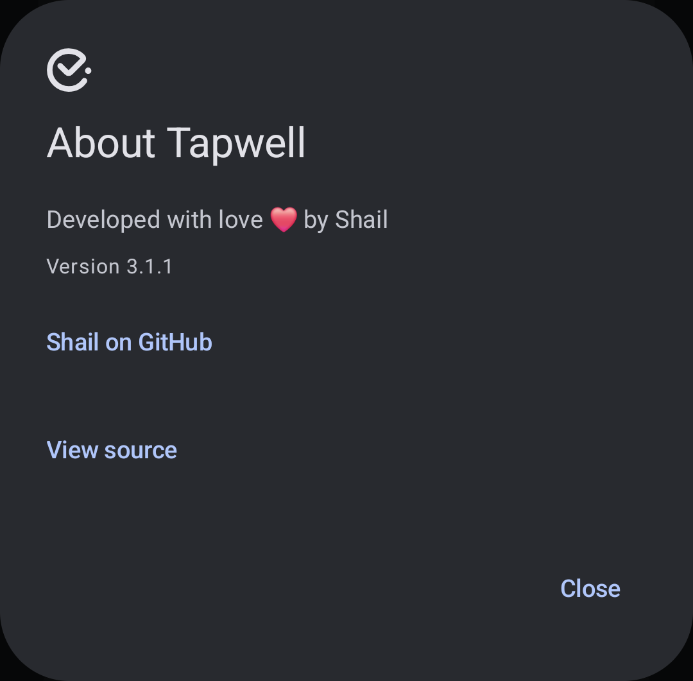
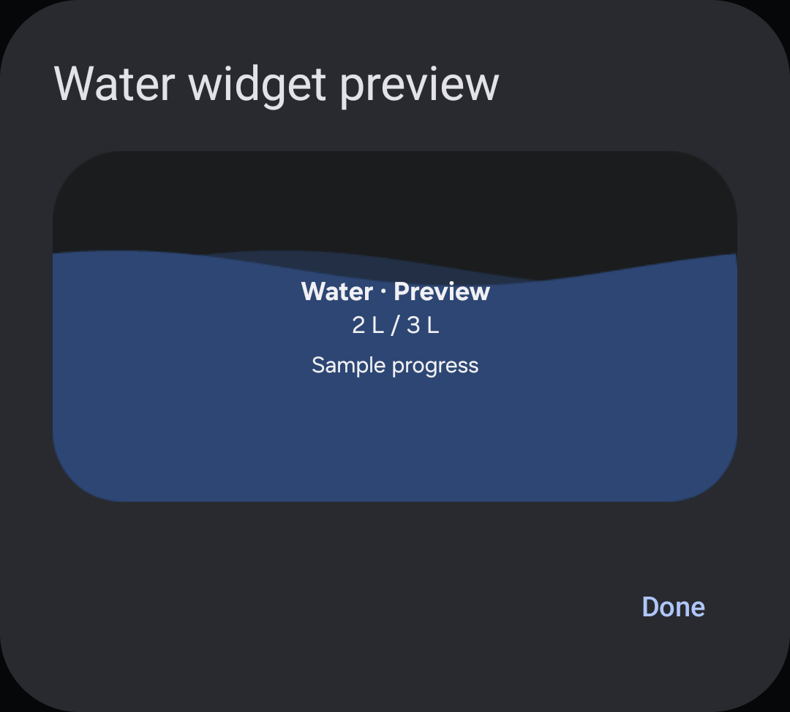

# Tapwell UI screenshots

Captured from Tapwell **3.1.1** on **Samsung S21 FE (SM-G990E)** in dark mode. Colors follow the device wallpaper palette; other phones and launchers can look different. The screens show setup/empty states from the test phone, including disabled Focus accessibility and paused Water reminders. They are not claims that those permissions are enabled.

System status and navigation bars were cropped from full-screen captures. About and Water preview images are cropped to the dialog to exclude private background screens. No UI was repainted or populated by inserting fake habit, sleep or health records. Images were visually reviewed for private account information, locations, NFC identities, notification contents and personal wallpaper before publication.

## Main destinations

| Focus | Habits |
| --- | --- |
|  |  |
| Sleep | Activity |
|  |  |
| Settings | About |
|  |  |

## Water widget preview

This is the app's explicitly labelled **sample preview**, not a real drink record or a launcher screenshot. The PNG captures one frame of the moving surface. It illustrates a two-thirds fill for a sample 2 L / 3 L goal; launcher-hosted motion, reduced-motion fallback and actual refresh behavior depend on the device. No background animation service is used.

## Updating the gallery

Follow [AGENTS.md](../../AGENTS.md) and [DESIGN.md](../../DESIGN.md). Capture actual installed screens, inspect every image, use non-sensitive states and update version/captions. Keep private full-screen originals and UI hierarchies in ignored local output. Do not publish an account screen, paired NFC code, medical habit name, personal wallpaper or real health journal merely because it is useful for testing.

See the [3.1.0 UI review](../ui-review-3.1.0.md) and [3.1.1 About check](../ui-review-3.1.1.md) for verification coverage and limits. Tap any image above to open the full-resolution PNG.
